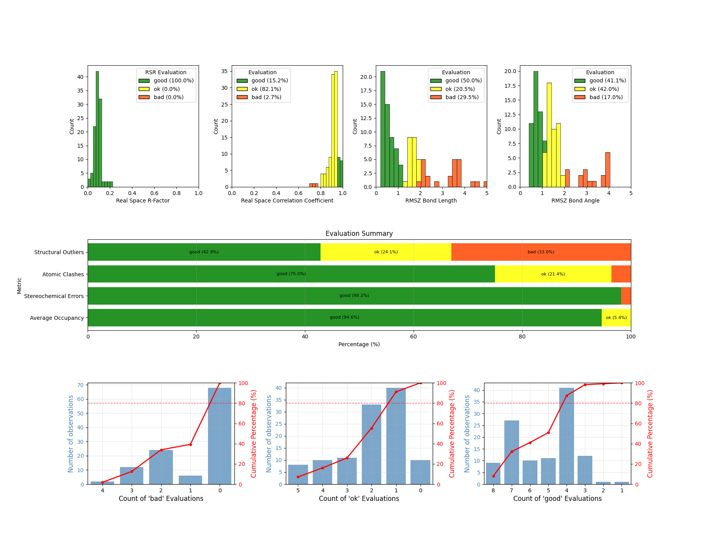

<a href="https://www.hds-lee.de/">
  
</a>
<a href="https://www.fz-juelich.de/en/ias/jsc">
  
</a>
<a href="https://www.fz-juelich.de/en/inm/inm-9">
  
</a>
<a href="https://www.rwth-aachen.de">
  
</a>

# :mag: LigandQC - Ligand Quality Check

In this project, we will scrape the ligand quality data from the Protein Data Bank using Python.
"Why?" you may ask? "Just look at the RCSB website report for the structure you're interested in, it's right there!" True, but what if you want to inspect the quality of a ligand across multiple PDB files? Or what if you want to inspect the quality of the ligands in a custom dataset of PDB files?
This is the solution to your problem. This tool will scrape the ligand quality data from the Protein Data Bank and provide a summary of the quality of the ligand. The tool will also provide a way to save the data to a csv file for further analysis.

# :sparkles: Features
* Scrape ligand quality data from the Protein Data Bank using a command line interface (CLI)
* Filter for Subject of Interest (SOI) ligands in a PDB file
* Filter for specific chains in a PDB file
* Save the data to a csv file for further analysis
* Create plots of the ligand quality data across multiple PDB files
* Download the ideal 3D coordinates of the ligand from the Cambridge Structural Database (CSD)
* Generate a report of the ligand quality data for a single ligand across multiple PDB files
* Compare the ligand quality data of one or more datasets

# :inbox_tray: Installation
To install the package, use one of the following methods.

## :card_file_box: From Source
First, clone this repository:

```bash
git clone https://jugit.fz-juelich.de/inm-9/ligand-quality-scraping.git
cd ligand-quality-scraping
```

Then, create a new python virtual environment using your favorite tool and install the required packages.
The following command will create a new virtual environment using micromamba and install the packages using poetry:

```bash
micromamba create -n ligand_quality -c conda-forge python==3.12 poetry
micromamba activate ligand_quality
poetry install
```

## :rocket: Package Manager
No package manager support yet.

# :joystick: Usage

Once the virtual environment is activated, you can use the tool as follows:

```bash
ligandqc --help
```

This will show you the available subcommands, arguments and options. There are currently five subcommands available: `inspect`, `download`, `plot`, `report` and `compare`.
The `inspect` subcommand is used to obtain the ligand quality data from the Protein Data Bank and save it to a file. The `download` subcommand is used to obtain the ideal 3D coordinates of the ligand from the Cambridge Structural Database (CSD) and save it to a file.
The `plot` subcommand is used to plot the obtained ligand quality data of one or more ligands across multiple PDB files.
The `report` subcommand is used to generate a report of the ligand quality data for a single ligand across multiple PDB files. The `compare` subcommand is used to compare the ligand quality data of one or more datasets.

## :mag: Inspection mode
The inspection mode is used to obtain the ligand quality data from the Protein Data Bank and save it to a file. The following command will inspect a single ligand in a PDB file and save the output to a yaml file:

```bash
ligandqc inspect INPUT_FILE OUTPUT_FILE
```

The `INPUT_FILE` is a `.txt` file containing the three letter ligand ids (one per line) that you want to inspect. The `OUTPUT_FILE` is the path to the output file where the results will be saved. The output file can be `.csv`, `.xlsx`, `.json`, `.yaml`, `.html`, or `.txt`.

There are several options available to customize the inspection process:
- `--only-chain`: Only inspect the specified chain in the PDB file. This option is useful if you want to inspect a specific chain in a multi-chain PDB file.
- `--logging-level`: Set the logging level. The default is `INFO`, but you can set it to `DEBUG` or `WARNING` to see more or less output.
- `--log-file`: Set the path to the log file. The default is `ligandqc.log`, but you can set it to any path you want.
- `--pdb-constraint-file`: Set the path to a `.txt` file containing the PDB IDs of the ligands you want to inspect. This option is useful if you want to inspect only specific PDB files.
- `--intermediate-save-file`: Set the path to a file where the intermediate results will be saved. This option is useful if you want to save intermediate results for long-running inspections.

## :bar_chart: Plotting mode
The plotting mode is used to plot the obtained ligand quality data of one or more ligands across multiple PDB files. The following command will plot the ligand quality data and save the output to a file:

```bash
ligandqc plot INPUT_FILE OUTPUT_FILE
```
The `INPUT_FILE` is the path to the input file containing the ligand quality data (`.csv`-file obtained from the inspection mode). The `OUTPUT_FILE` is the path to the output file where the plot will be saved. The output file can be `.png`, or `.svg`.

here's an example of the ligand quality fo the ligand `4WI`, also known as Nirmatrelvir, a protease inhibitor used in the treatment of COVID-19. As of 2025-05-05, 84 ligand quality entries are available in the PDB.



## :inbox_tray: Download mode
The download mode is used to obtain the ideal 3D coordinates of the ligand from the Cambridge Structural Database (CSD) and save it to a file. The following command will download the ideal 3D coordinates of a ligand and save it to a file:

```bash
ligandqc download LIGAND_ID OUTPUT_FILE
```


# :brain: Rationale
The goal of this project is to provide a simple and easy to use tool to inspect the quality of ligands in protein structures. The tool will scrape the data from the Protein Data Bank and provide a summary of the quality of the ligand. The tool will also provide a way to save the data to a csv file for further analysis.
The tool is intended to be used by researchers and scientists who want to quickly inspect the quality of ligands in protein structures.
Currently, in the Protein Data Bank there are multiple metrics that are used to assess the quality of ligands in protein structures. These metrics are not always easy to find and compare, especially for large datasets.
The metrics provided are:
- Real Space R-factor (RSR)
- Real Space Correlation Coefficient (RSCC)
- RMSZ-bond-length
- RMSZ-bond-angle
- Outliers of bond length
- Outliers of bond angle
- Average occupancy
- Atomic clashes
- Stereo-chemical errors

The above mentioned metrics alone are not sufficient to assess the quality of a ligand. Together they can provide a good overview.
In this tool, the ligand stuctures are categorized into "Good", "OK" and "Bad" based rule of thumbs for each metric. An overall category is assigned based on the worst metric category obtained. "Outliers of bond length" and "Outliers of bond angle" have been summarized into "Structural outliers".

The rule of thumbs go as follows:

| metric                  | Good       | OK            | Bad        | citation                                  |
|-------------------------|------------|---------------|------------|-------------------------------------------|
| RSR                     | <= 0.4     | -             | > 0.4      | https://doi.org/10.1107/S2059798318002541 |
| RSCC                    | >= 0.95    | >= 0.8        | < 0.8      | https://doi.org/10.1107/S2059798318002541 |
| RMSZ-bond-length        | *          | <= 2.0        | > 2.0      | [Link to Mogul FAQ](https://support.ccdc.cam.ac.uk/support/solutions/articles/103000306395-what-is-the-z-score-listed-in-the-summary-statistics-for-each-3d-bond-and-valence-angle-search-result)<br>accessed 2024-04-14                             |
| RMSZ-bond-angle         | *          | <= 2.0        | > 2.0      | [Link to Mogul FAQ](https://support.ccdc.cam.ac.uk/support/solutions/articles/103000306395-what-is-the-z-score-listed-in-the-summary-statistics-for-each-3d-bond-and-valence-angle-search-result)<br>accessed 2024-04-14                             |
| Structural Outliers     | <= 5       | <= 15         | > 15       | -                                         |
| Average occupancy       | >= 0.95    | >= 0.5        | < 0.5      | -                                         |
| Atomic clashes          | 0          | <= 2          | > 2        | -                                         |
| Stereo-chemical errors  | 0          | -             | > 0        | https://doi.org/10.1016/j.str.2021.10.003 |

## :rotating_light: RMSZ values
The Z-value $Z_i$ describes the deviation of a value $X_i$ from the mean of a population $\mu$ in units of standard deviation $\sigma$.
The Z-value is calculated as follows:

```math
Z_i = \frac{X_i - \mu}{\sigma}
```

Where $N$ is the number of values, the $RMSZ$ value is calculated as follows:

```math
RMSZ = \sqrt{\frac{1}{N} \sum_{i=1}^{N} Z_i^2}
```

The Z-values are normalized to have a mean of 0, therefore the RMSZ value is equivalent to the *standard deviation* of the Z-values. 
Applying this to the RMSZ-bond-length and RMSZ-bond-angle metrics, we can see that the RMSZ value for the ligand is a measure of the deviation of the bond lengths/angles from the mean bond lengths/angles of the specific type.
To evaluate the provided RMSZ value, we need to know if the sample size (number of bonds/angles in a ligand) is large enough to prove statistical deviation from the underlying general population.
This is done by performing a series of **F-tests for equality of variances**. 

The F-test is a statistical test that compares the variances of two populations. The null hypothesis is that the variances are equal, and the alternative hypothesis is that the variances are not equal. The F-test returns a p-value, which is the probability of observing the data given that the null hypothesis is true. If the p-value is less than a certain threshold (usually 5%), we reject the null hypothesis and conclude that the variances are not equal.
For each ligand, the number of bonds/angles was determined by analysing the molecular structure of the ligand as obtained from the RCSB Ligand Expo using rdkit. 
A treshold-RMSZ value is determined, below which no statistical deviation can be proven.

Using a bisectional search, the treshold-RMSZ value is determined, below which no statistical deviation can be proven.
The size of the true population was chosen to be 1E7, which is large enough to be considered infinite compared to the number of bonds/angles typically found in a ligand which we assume to be in the range of 5-200.

<p align="middle">
    
    
</p>

# :alembic: Examples

Take a look at the 'example_analyses' folder for three examples of how to use the tool. In that folder, there are analyses for (1) all ligands in the PDB, (2) covalent ligands of SARS-CoV-2 Mpro and (3) the ligand Nirmatrelvir (4WI) in the PDB.

Below is an example of how to inspect the ligand quality of the ligand `4WI` in the PDB file `7TLL` for chain `A`. The following command will inspect the ligand quality and save the output to a yaml file:

```bash
cat > ligand_ids.txt << EOF
4WI
EOF

cat > pdb_ids.txt << EOF
7TLL
EOF

ligandqc inspect \
    -i ligand_ids.txt \
    -o output.yaml \
    --pdb-constraint-file pdb_ids.txt \
    --only-chain "A"
```

yields the following output:

```yaml
Atomic clashes: 0
Atomic clashes Evaluation: good
Average occupancy: 1.0
Average occupancy Evaluation: good
Chain ID: A
Identifier: 7TLL_4WI_A_401
Ligand ID: 4WI
Ligand occurence in PDB: 7
Model completeness: 1.0
Outliers of bond angle: 5
Outliers of bond length: 3
PDB ID: 7TLL
RMSZ Bond Angle: 1.23
RMSZ Bond Angle Evaluation: ok
RMSZ Bond Length: 1.43
RMSZ Bond Length Evaluation: ok
Ranking for geometry: 0.33
Ranking for goodness of fit: 0.71
Real Space R-Factor: 0.09
Real Space R-Factor Evaluation: good
Real Space Correlation Coefficient: 0.908
Real Space Correlation Coefficient Evaluation: ok
Stereochemical Errors: 0
Stereochemical Errors Evaluation: good
Structural Outliers: 8
Structural Outliers Evaluation: ok
```

# :loudspeaker: Acknowledgements
Contributors:
- Christian Bergeest
- Andrea Rizzi
- Mercedes Alfonso-Prieto
- Davide Mandelli
- Ira Assent
- Thomas Berlage
- Giulia Rossetti

This work was performed as part of the Helmholtz School for Data Science in Life, Earth and Energy (HDS-LEE) and received funding from the Helmholtz Association of German Research Centres.
The authors would like to thank the Jülich Supercomputing Centre (JSC) for providing the computational resources and support.