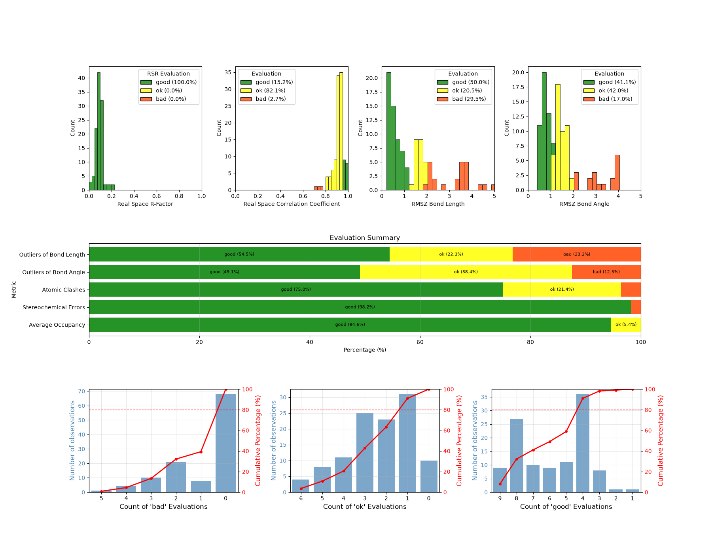
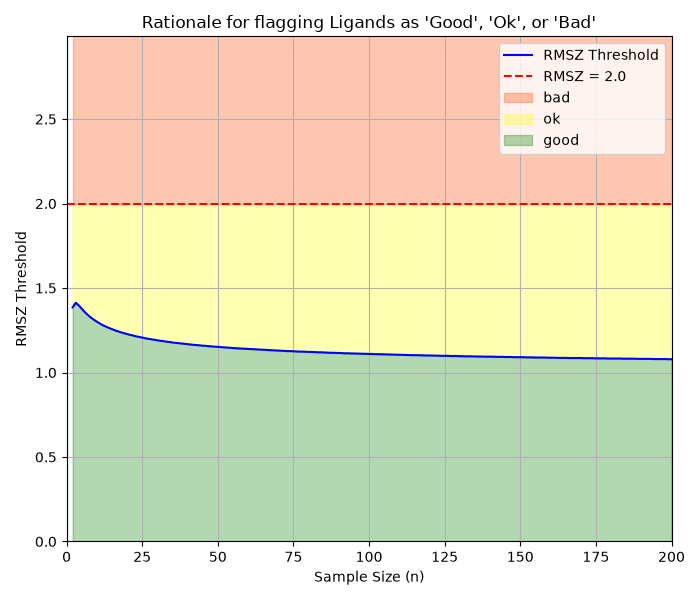
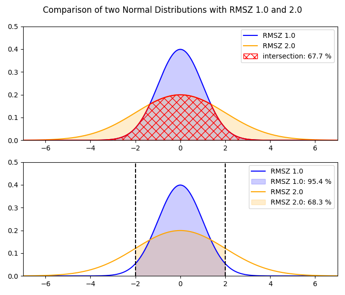

<a href="https://www.hds-lee.de/">
  
</a>
<a href="https://www.fz-juelich.de/en/ias/jsc">
  
</a>
<a href="https://www.fz-juelich.de/en/inm/inm-9">
  
</a>
<a href="https://www.rwth-aachen.de">
  
</a>


# :mag: LigandQC - Ligand Quality Check

LigandQC is a python package with a command line interface (CLI) to check the quality 
of one or more ligands in protein structures via the RSCB API. The provided quality metrics are
categorized into "Good", "OK" and "Bad" based on rule of thumbs or statistical considerations for 
each metric.

The CLI provides commands to retrieve and evaluate the quality metrics as well as generate plots 
and reports from the generated data. The tool can be used to download ligand structures from the
Cambridge Structural Database (CSD) and compare the quality metrics and dataset overlap of up to 
three datasets at once. A utility command is provided to analyze the entire PDB as a whole.

The tool is intended to be used by researchers and scientists who want to perform analyses or 
simulations on a dataset of protein-ligand complexes and want to quickly inspect the quality of 
the ligands in their curated dataset.
Tutorials and example analyses on how to use the python package or the CLI are provided in the 
[repository](https://github.com/FZJ-INM-9/LigandQC) and the [documentation](https://readthedocs.org/projects/ligandqc/).


# :sparkles: Features
* Scrape ligand quality data from the Protein Data Bank using a command line interface (CLI).
* Filter for Subject of Interest (SOI) ligands in a PDB file.
* Filter for specific chains in a PDB file.
* Save the data to a csv file for further analysis.
* Create plots of the ligand quality data across multiple PDB files.
* Download the ideal 3D coordinates of the ligand from the Cambridge Structural Database (CSD).
* Generate a report of the ligand quality data for a single ligand across multiple PDB files.
* Compare the ligand quality data of multiple datasets.

# :inbox_tray: Installation
To install the package, use one of the following methods.

## :card_file_box: From Source
First, clone this repository:

```bash
git clone https://github.com/FZJ-INM-9/LigandQC.git
cd LigandQC
```

Then, create a new python virtual environment using your favorite tool and install the required packages.
The following command will create a new virtual environment using micromamba and install the packages using poetry:

```bash
micromamba create -n ligandqc -c conda-forge python==3.12 poetry
micromamba activate ligandqc
poetry install
```

## :rocket: Package Manager
No package manager support yet.

# :joystick: Usage

Once the virtual environment is activated, you can use the tool as follows:

```bash
ligandqc --help
```

This shows the available subcommands and options. The project currently exposes the following CLI commands via Click: `inspect`, `download`, `plot`, `report`, `compare`, and `get-all-ids`.

Typical command patterns are:

```bash
ligandqc inspect --ligand-id-file ligand_ids.txt --output-file output.csv
ligandqc download --ligand-id-file ligand_ids.txt --output-directory ./ligands
ligandqc plot --input-file quality_data.csv --output-file quality_plot.png
ligandqc report --input quality_data.csv --output terminal
ligandqc compare --output-dir comparison_results dataset1.csv dataset2.csv
ligandqc get-all-ids
```

The `inspect` subcommand reads ligand IDs from a text file and optionally filters by chain or by a list of PDB IDs. The `download` subcommand reads ligand IDs from a file and writes one `.sdf` structure per ligand to an output directory. The `plot` subcommand reads a CSV produced by `inspect` and saves a plot to disk. The `report` command generates a tabular or HTML report from the same CSV input. The `compare` subcommand compares one or more CSV datasets and writes comparison outputs to a directory. The `get-all-ids` command fetches the PDB mapping of ligand IDs and PDB IDs and writes the corresponding files.

For more information on the available commands and options, please refer to the [documentation](https://readthedocs.org/projects/ligandqc/).

## :mag: Inspection mode
The inspection mode is used to obtain ligand quality data from the Protein Data Bank and save it to a file. The following command inspects a batch of ligands and writes the results to a YAML file:

```bash
ligandqc inspect \
    --ligand-id-file ligand_ids.txt \
    --output-file output.yaml \
    --pdb-constraint-file pdb_ids.txt \
    --only-chain "A"
```

The `--ligand-id-file` option points to a `.txt` file containing one three-letter ligand ID per line. The `--output-file` option sets the destination file. Supported output formats are `.csv`, `.xlsx`, `.json`, `.yaml`, `.yml`, `.html`, `.txt`, and `.md`.

There are several options available to customize the inspection process:
- `--only-chain`, `-oc`: Only inspect the specified chain in the PDB file.
- `--only-SOI`, `-os`: Restrict the inspection to ligands flagged as Subject of Investigation.
- `--logging-level`, `-ll`: Set the logging level. The default is `INFO`, with choices `DEBUG`, `INFO`, `WARNING`, `ERROR`, and `CRITICAL`.
- `--log-file`, `-lf`: Set the path to the log file. The default is `ligandqc.log`.
- `--pdb-constraint-file`, `-pcf`: Restrict the results to a `.txt` file with one PDB ID per line.

## :bar_chart: Plotting mode
The plotting mode reads a ligand-quality CSV file and saves a plotted summary to disk. The command is:

```bash
ligandqc plot --input-file quality_data.csv --output-file quality_plot.png
```

The `--input-file` option expects the CSV output produced by the `inspect` command. The `--output-file` option can point to formats such as `.png`, `.svg`, or other formats supported by Matplotlib.

Here's an example of the ligand quality for `4WI`, also known as Nirmatrelvir, a protease inhibitor used in the treatment of COVID-19. The repository includes rendered example outputs under the documentation and example-analysis folders.



## :inbox_tray: Download mode
The download mode retrieves ideal 3D coordinates for ligands from the Cambridge Structural Database (CSD) and saves them as `.sdf` files in a target directory. The command is:

```bash
ligandqc download --ligand-id-file ligand_ids.txt --output-directory ./ligands
```

The file passed via `--ligand-id-file` contains one ligand ID per line. Each downloaded structure is written to the output directory as `LIGANDID.sdf`.

## :clipboard: Reporting and comparison modes
The project also includes helper commands for post-processing the inspection data:

```bash
ligandqc report --input quality_data.csv --output report.html
ligandqc compare --output-dir comparison_results dataset1.csv dataset2.csv dataset3.csv
```

The `report` command generates a human-readable report from a CSV table, while `compare` compares multiple datasets and writes plots and tables to the specified output directory.


# :brain: Rationale
The goal of this project is to provide a simple and easy to use tool to inspect the quality of ligands in protein structures. The tool will scrape the data from the Protein Data Bank and provide a summary of the quality of the ligand. The tool will also provide a way to save the data to a csv file for further analysis.
The tool is intended to be used by researchers and scientists who want to quickly inspect the quality of ligands in protein structures.
Currently, in the Protein Data Bank there are multiple metrics that are used to assess the quality of ligands in protein structures. These metrics are not always easy to find and compare, especially for large datasets.

The metrics provided are:
- Real Space R-factor (RSR)
- Real Space Correlation Coefficient (RSCC)
- RMSZ-bond-length
- RMSZ-bond-angle
- Outliers of bond length
- Outliers of bond angle
- Average occupancy
- Atomic clashes
- Stereo-chemical errors

The above mentioned metrics alone are not sufficient to assess the quality of a ligand. Together they can provide a good overview.
In this tool, the ligand stuctures are categorized into "Good", "OK" and "Bad" based rule of thumbs for each metric. An overall category is assigned based on the worst metric category obtained. The outlier rates for bond lengths and bond angles are evaluated independently as percentages of the total bond and angle counts.

The rule of thumbs go as follows:

| metric                  | Good       | OK            | Bad        | citation                                  |
|-------------------------|------------|---------------|------------|-------------------------------------------|
| RSR                     | <= 0.4     | -             | > 0.4      | https://doi.org/10.1107/S2059798318002541 |
| RSCC                    | >= 0.95    | >= 0.8        | < 0.8      | https://doi.org/10.1107/S2059798318002541 |
| RMSZ-bond-length        | *          | <= 2.0        | > 2.0      | [Link to Mogul FAQ](https://support.ccdc.cam.ac.uk/support/solutions/articles/103000306395-what-is-the-z-score-listed-in-the-summary-statistics-for-each-3d-bond-and-valence-angle-search-result)<br>accessed 2024-04-14                             |
| RMSZ-bond-angle         | *          | <= 2.0        | > 2.0      | [Link to Mogul FAQ](https://support.ccdc.cam.ac.uk/support/solutions/articles/103000306395-what-is-the-z-score-listed-in-the-summary-statistics-for-each-3d-bond-and-valence-angle-search-result)<br>accessed 2024-04-14                             |
| Outliers of bond length | <= 10%     | <= 25%        | > 25%      | -                                         |
| Outliers of bond angle  | <= 10%     | <= 25%        | > 25%      | -                                         |
| Average occupancy       | >= 0.95    | >= 0.5        | < 0.5      | -                                         |
| Atomic clashes          | 0          | <= 2          | > 2        | -                                         |
| Stereo-chemical errors  | 0          | -             | > 0        | https://doi.org/10.1016/j.str.2021.10.003 |

## :rotating_light: RMSZ values
The Z-value $Z_i$ describes the deviation of a value $X_i$ from the mean of a population $\mu$ in units of standard deviation $\sigma$.
The Z-value is calculated as follows:

```math
Z_i = \frac{X_i - \mu}{\sigma}
```

Where $N$ is the number of values, the $RMSZ$ value is calculated as follows:

```math
RMSZ = \sqrt{\frac{1}{N} \sum_{i=1}^{N} Z_i^2}
```

The Z-values are normalized to have a mean of 0, therefore the RMSZ value is equivalent to the *standard deviation* of the Z-values. 

```math
s_z = \sqrt{\frac{k}{k-1}} \text{RMSZ}
```

Applying this to the RMSZ Bond Length and RMSZ Bond Angle 
metrics, we can see that the RMSZ value for the ligand is a measure of the deviation of the bond
lengths/angles from the mean bond lengths/angles of the specific type.
To evaluate the provided RMSZ value, we need to know if the sample size (number of bonds/angles 
in a ligand) is large enough to prove statistical deviation from the underlying general population.
This is done by performing a series of **F-tests for equality of variances**. 

The F-test is a statistical test that compares the variances of two populations. The null hypothesis 
is that the variances are equal, and the alternative hypothesis is that the variances are not equal. 
The F-test returns a p-value, which is the probability of observing the data given that the null 
hypothesis is true. If the p-value is less than a certain threshold (usually 5%), the null 
hypothesis is rejected and we conclude that the variances are not equal.
In this software the number of bonds/angles are scraped from the RCSB API along with the RMSZ values. 
Using a bisectional search algorithm, the treshold-RMSZ value is determined, below which no 
statistical deviation from the reference distribution can be proven.
The size of the true population was set to be 1E7, which is large enough to be considered infinite
compared to the number of bonds/angles typically found in a ligand which we assume to be typically in the 
range of 5-200.

<p align="middle">
    
    
</p>

# :alembic: Examples

Take a look at the `examples/` directory for example analyses of how to use the tool. The repository currently includes analyses for (1) all ligands in the PDB, (2) covalent ligands of SARS-CoV-2 Mpro, and (3) the ligand Nirmatrelvir (4WI) in the PDB.

Below is an example of how to inspect the ligand quality of the ligand `4WI` in the PDB file `7TLL` for chain `A`. The following command will inspect the ligand quality and save the output to a yaml file:

```bash
cat > ligand_ids.txt << EOF
4WI
EOF

cat > pdb_ids.txt << EOF
7TLL
EOF

ligandqc inspect \
    --ligand-id-file ligand_ids.txt \
    --output-file output.yaml \
    --pdb-constraint-file pdb_ids.txt \
    --only-chain "A"
```

yields the following output:

```yaml
- Atomic Clashes: 1
  Atomic Clashes Evaluation: ok
  Average Occupancy: 1.0
  Average Occupancy Evaluation: good
  Chain ID: A
  Experimental Method: X-RAY DIFFRACTION
  Is Subject of Investigation: true
  Ligand ID: 4WI
  Ligand occurence in PDB: not evaluated.
  Model completeness: 1.0
  Number of angles: 46
  Number of atoms: 35
  Number of bonds: 34
  Outliers of Bond Angle: 5
  Outliers of Bond Angle Evaluation: ok
  Outliers of Bond Length: 3
  Outliers of Bond Length Evaluation: good
  PDB ID: 7TLL
  RMSZ Bond Angle: 1.18
  RMSZ Bond Angle Evaluation: ok
  RMSZ Bond Length: 1.4
  RMSZ Bond Length Evaluation: ok
  Ranking for geometry: 0.3414
  Ranking for goodness of fit: 0.6644
  Real Space Correlation Coefficient: 0.921
  Real Space Correlation Coefficient Evaluation: ok
  Real Space R-Factor: 0.081
  Real Space R-Factor Evaluation: good
  Residue ID: '401'
  Stereochemical Errors: 0
  Stereochemical Errors Evaluation: good
```

# :loudspeaker: Acknowledgements
Contributors:
- Christian Bergeest
- Andrea Rizzi
- Mercedes Alfonso-Prieto
- Davide Mandelli
- Ira Assent
- Thomas Berlage
- Giulia Rossetti

This work was performed as part of the Helmholtz School for Data Science in Life, Earth and Energy (HDS-LEE) and received funding from the Helmholtz Association of German Research Centres.
The authors would like to thank the Jülich Supercomputing Centre (JSC) for providing the computational resources and support.